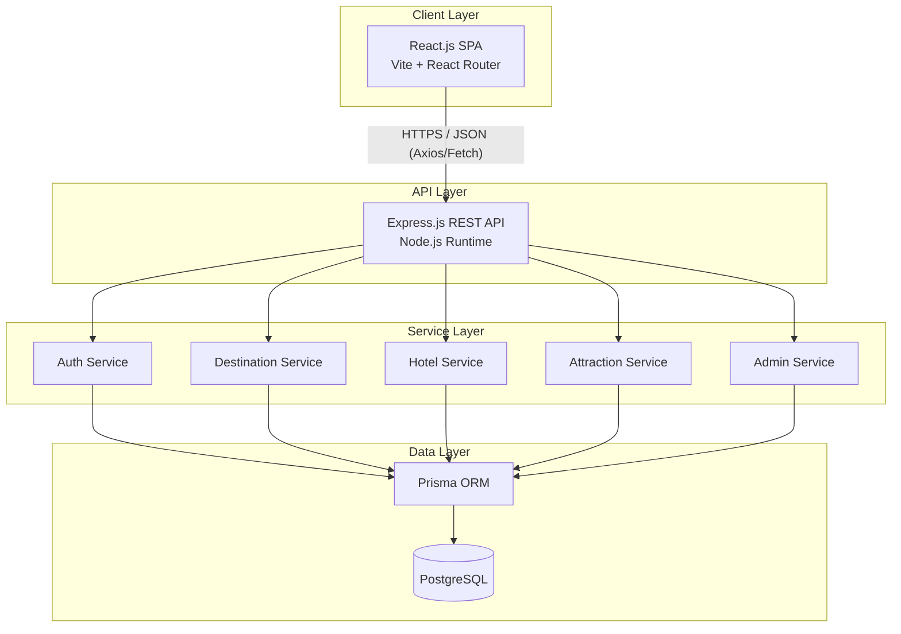
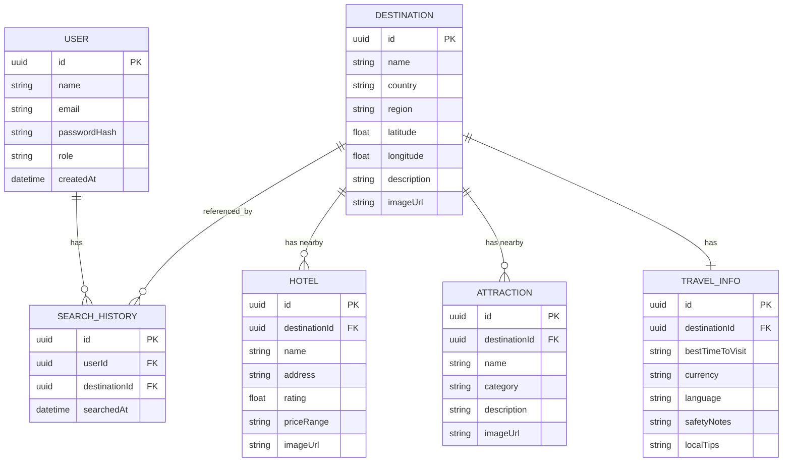
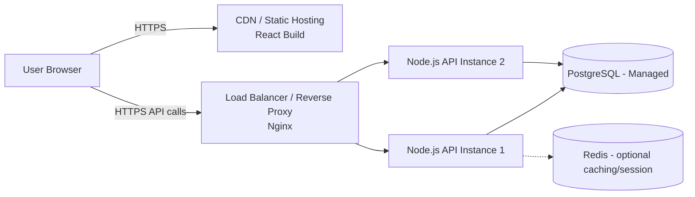

# Technical Architecture Document
## Travel Discovery Application

---

## 1. High-Level Architecture



The system follows a classic **3-tier architecture**: presentation (React SPA), application/business logic (Express.js REST API on Node.js), and data (PostgreSQL via Prisma ORM). The frontend and backend are decoupled and communicate exclusively over a versioned REST API.

## 2. Frontend Architecture (React.js)

### 2.1 Structure
```
client/
├── src/
│   ├── components/         # Reusable UI components (Navbar, HotelCard, AttractionCard, MapPanel...)
│   ├── pages/              # Login, Register, Dashboard, DestinationDetail
│   ├── features/           # Feature-sliced modules (auth, destinations, hotels, attractions)
│   ├── hooks/               # Custom hooks (useAuth, useDebouncedSearch)
│   ├── context/            # AuthContext / global state
│   ├── services/           # Axios API clients
│   ├── animations/         # Framer Motion variants
│   ├── routes/             # ProtectedRoute wrapper, route config
│   └── App.jsx
```

### 2.2 State Management
- **Local/UI state:** React `useState`/`useReducer`
- **Server state / caching:** React Query (TanStack Query) — handles caching, retries, background refetch for destination/hotel/attraction data
- **Auth state:** Context API + JWT stored in memory/HttpOnly cookie (see Security doc)

### 2.3 Routing
- `react-router-dom` v6+
- Public routes: `/login`, `/register`
- Protected routes (wrapped by `ProtectedRoute`): `/dashboard`, `/destination/:id`

### 2.4 UI & Animation Layer
- **Framer Motion** for page transitions, card hover/entry animations, modal transitions
- **GSAP** (optional) for more complex scroll-triggered effects on the landing/dashboard
- Skeleton loaders during data fetch to keep perceived performance high

## 3. Backend Architecture (Node.js + Express.js)

### 3.1 Structure (Layered / MVC-inspired)
```
server/
├── src/
│   ├── routes/             # Express routers (auth.routes.js, destination.routes.js, ...)
│   ├── controllers/        # Request/response handling
│   ├── services/           # Business logic
│   ├── repositories/       # Prisma queries isolated from services
│   ├── middlewares/        # auth.middleware, error.middleware, rbac.middleware, rateLimit.middleware
│   ├── validators/         # Request validation (Zod/Joi)
│   ├── utils/              # JWT helper, password hasher, logger
│   ├── prisma/             # schema.prisma, migrations, seed.js
│   └── app.js / server.js
```

### 3.2 API Design
- RESTful, versioned: `/api/v1/...`
- Resource-oriented endpoints:

| Method | Endpoint | Purpose | Access |
|---|---|---|---|
| POST | `/api/v1/auth/register` | Create account | Public |
| POST | `/api/v1/auth/login` | Authenticate, issue JWT | Public |
| POST | `/api/v1/auth/logout` | Invalidate session | User |
| GET | `/api/v1/destinations?query=` | Search destinations | User |
| GET | `/api/v1/destinations/:id` | Destination detail | User |
| GET | `/api/v1/destinations/:id/hotels` | Hotels near destination | User |
| GET | `/api/v1/destinations/:id/attractions` | Attractions near destination | User |
| GET | `/api/v1/destinations/:id/travel-info` | Essential travel info | User |
| POST/PUT/DELETE | `/api/v1/admin/destinations/:id` | Manage destinations | Admin |
| POST/PUT/DELETE | `/api/v1/admin/hotels/:id` | Manage hotels | Admin |
| POST/PUT/DELETE | `/api/v1/admin/attractions/:id` | Manage attractions | Admin |

### 3.3 Middleware Pipeline
`CORS → Helmet → Rate Limiter → Body Parser → Auth (JWT verify) → RBAC → Controller → Error Handler`

## 4. Database Architecture (PostgreSQL + Prisma)

### 4.1 Entity Relationship Overview



### 4.2 Prisma ORM Role
- Single source of schema truth (`schema.prisma`)
- Type-safe query client generated for Node.js backend
- Handles migrations (`prisma migrate dev` / `deploy`)
- Connection pooling via Prisma's engine (or PgBouncer in production for high concurrency)

### 4.3 Indexing Strategy
- Full-text/trigram index on `Destination.name` and `country` for fast search (`pg_trgm` extension)
- Foreign key indexes on `destinationId` in `Hotel`, `Attraction`, `TravelInfo`
- Composite index on `SearchHistory(userId, searchedAt)` for history queries

## 5. Deployment Architecture



- **Frontend:** Built via Vite, deployed to static hosting/CDN (Vercel/Netlify/S3+CloudFront)
- **Backend:** Containerized (Docker), deployed behind Nginx reverse proxy, horizontally scalable
- **Database:** Managed PostgreSQL (e.g., RDS/Supabase/Railway) with automated backups
- **Optional caching:** Redis for session/token blacklist and hot destination-search caching

## 6. Map / Route Component (No External API)

Since no third-party travel APIs are used, the "route/location information" panel is implemented with:
- **Leaflet.js** + **OpenStreetMap tiles** (free, no API key required) to render destination coordinates stored in the DB
- Distance/region context computed server-side from stored latitude/longitude (haversine formula) against other destinations or landmark records in the DB — not live routing/navigation
