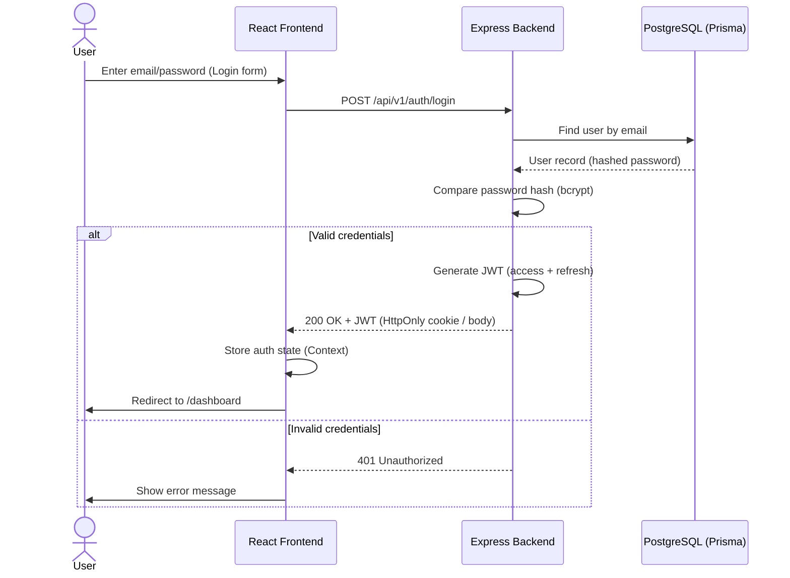
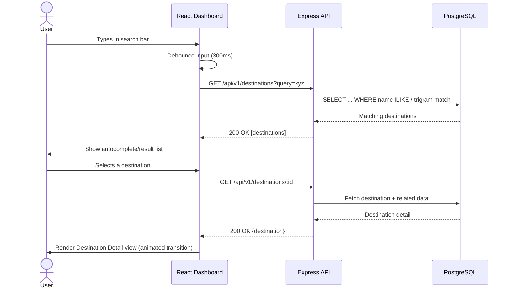
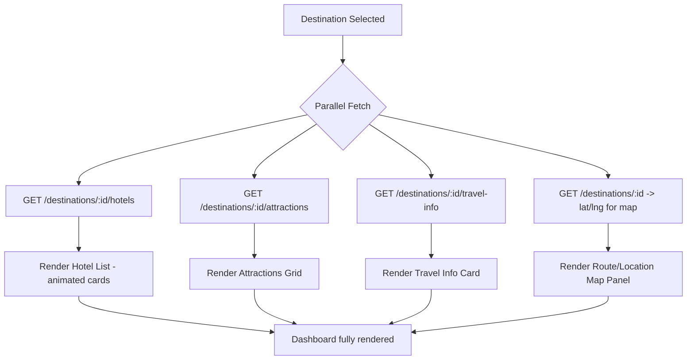
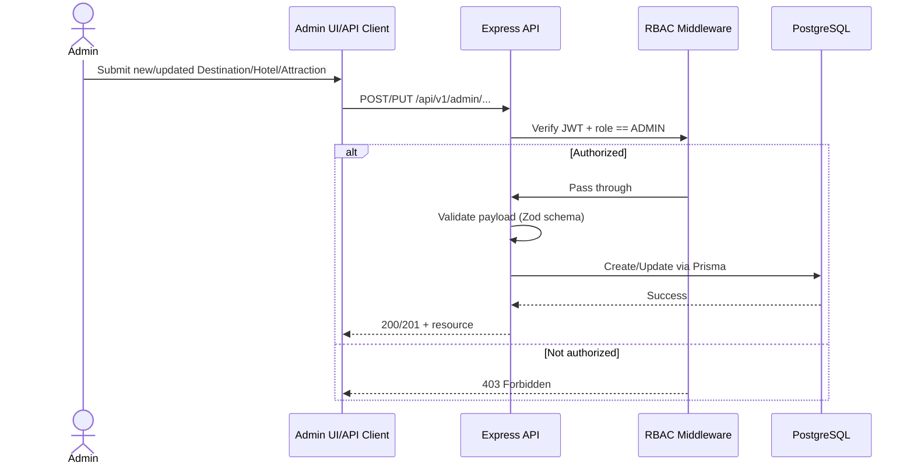
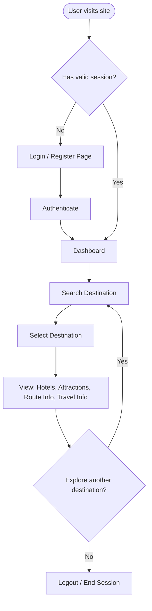
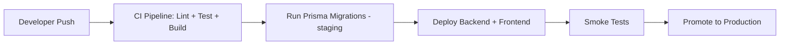

# Software Workflow Document
## Travel Discovery Application

---

## 1. User Authentication Workflow

## 2. Destination Search & Selection Workflow

## 3. Dashboard Data Aggregation Workflow

Once a destination is selected, the frontend fires parallel requests to populate the dashboard panels:

React Query manages these calls with independent loading/error states per panel, so one slow/failed request doesn't block the rest of the dashboard.

## 4. Admin Content Management Workflow

## 5. Overall Application Flow (End-to-End)

## 6. Error Handling Workflow

- All backend errors funnel through a centralized Express error-handling middleware.
- Errors are categorized: `ValidationError (400)`, `AuthError (401)`, `ForbiddenError (403)`, `NotFoundError (404)`, `ServerError (500)`.
- Frontend uses a global Axios interceptor to catch 401s → auto-redirect to login (session expired) and surface toast notifications for other errors (animated toast component).

## 7. CI/CD Workflow (Recommended)

