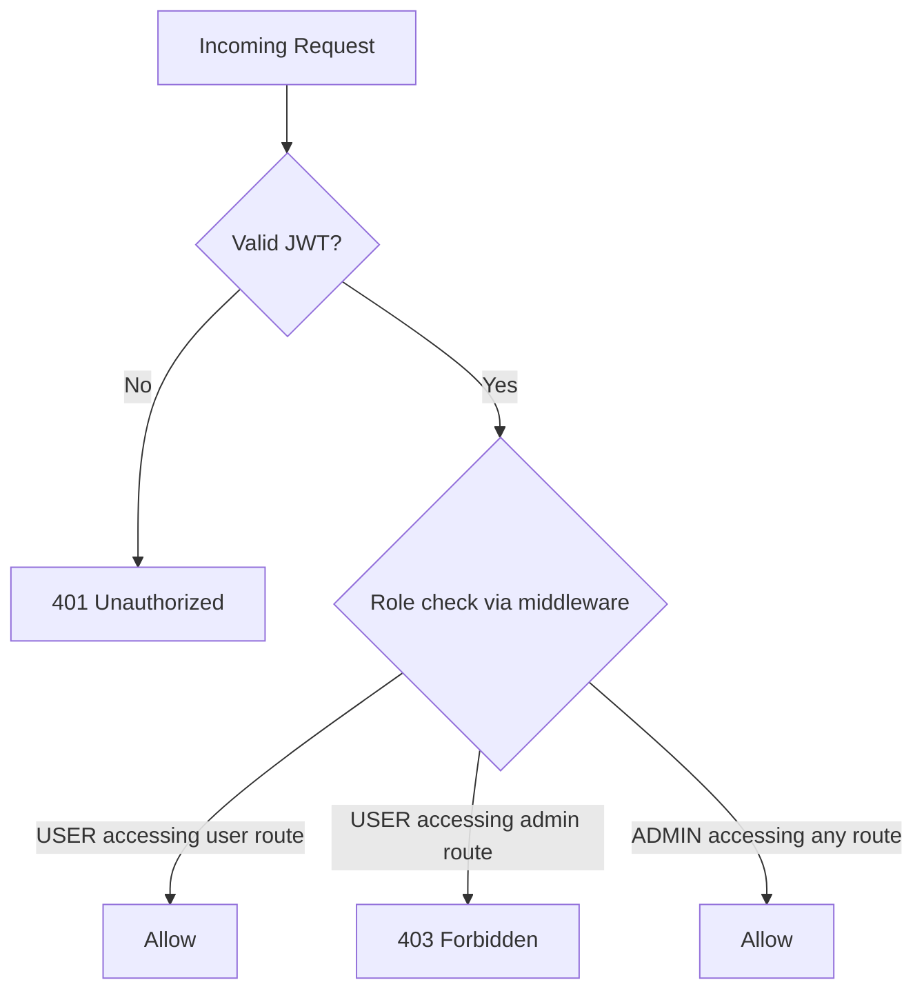

# Security Architecture Document
## Travel Discovery Application

---

## 1. Security Objectives

- Protect user credentials and session integrity
- Prevent unauthorized access to admin functions (RBAC)
- Prevent common web vulnerabilities (OWASP Top 10)
- Protect data in transit and at rest
- Ensure the database layer is not directly exposed

## 2. Authentication & Session Security

| Control | Implementation |
|---|---|
| Password storage | Hashed with **bcrypt** (cost factor ≥ 12) or **argon2**; never stored/logged in plaintext |
| Session mechanism | **JWT** (access token, short-lived ~15 min) + **refresh token** (long-lived, HttpOnly, Secure cookie, rotated on use) |
| Token storage | Access token kept in memory (not localStorage, to reduce XSS token theft risk); refresh token in `HttpOnly`, `Secure`, `SameSite=Strict` cookie |
| Brute-force protection | Rate limiting on `/auth/login` and `/auth/register` (e.g., 5 attempts / 15 min / IP via `express-rate-limit`) |
| Logout | Refresh token revoked server-side (stored/blacklisted in DB or Redis) |

## 3. Authorization (RBAC)

- Two roles for MVP: `USER`, `ADMIN` (extensible later to `MODERATOR` etc.)
- Role stored in the JWT payload **and** re-validated against DB on sensitive admin actions to prevent stale-token privilege issues.
- Middleware chain: `authenticate` → `authorize(['ADMIN'])` applied per-route.

## 4. Input Validation & Injection Prevention

- All incoming request bodies validated with **Zod** (or Joi) schemas before reaching business logic.
- **Prisma ORM** parameterizes all queries automatically — eliminates classic SQL injection risk (no raw string-concatenated SQL).
- Where `$queryRaw` is unavoidable (e.g., complex geo/trigram search), always use Prisma's tagged-template parameterization, never string interpolation.
- File/image upload fields (if added later) validated for MIME type, size limits, and stored outside the web root or in object storage (S3-compatible), never executed.

## 5. Transport & Network Security

- **HTTPS/TLS** enforced everywhere (HSTS header enabled); HTTP requests redirected to HTTPS.
- **CORS** restricted to the known frontend origin(s) only — no wildcard `*` in production.
- **Helmet.js** middleware sets secure HTTP headers (CSP, X-Content-Type-Options, X-Frame-Options, Referrer-Policy).
- Database not publicly exposed — accessible only from backend's private network/VPC; connections enforced over SSL (`sslmode=require` in Prisma datasource URL).

## 6. Application-Layer Protections (OWASP Top 10 mapping)

| OWASP Risk | Mitigation |
|---|---|
| Broken Access Control | RBAC middleware, route-level guards, server-side re-validation |
| Cryptographic Failures | bcrypt/argon2 hashing, TLS in transit, secrets in env vars/secret manager |
| Injection | Prisma parameterized queries, Zod input validation |
| Insecure Design | Threat modeling during design (this doc), least-privilege DB user for the app |
| Security Misconfiguration | Helmet defaults, disabled stack traces in prod error responses, dependency scanning |
| Vulnerable Components | Automated `npm audit` / Dependabot in CI |
| Auth Failures | Rate limiting, account lockout thresholds, strong password policy enforcement |
| Data Integrity Failures | JWT signature verification (HS256/RS256), CSRF protection on cookie-based flows |
| Logging & Monitoring Failures | Centralized structured logging (Winston/Pino), audit log for admin CRUD actions |
| SSRF | N/A for MVP (no external API calls from backend), reassessed if external APIs added later |

## 7. CSRF Protection

- Since refresh tokens live in cookies, CSRF protection is required for state-changing requests:
  - `SameSite=Strict` cookie attribute as first line of defense
  - CSRF token pattern (double-submit cookie) for any cookie-authenticated mutating endpoint
- Access-token-authenticated (Bearer header) API calls from the SPA are inherently less CSRF-prone since tokens aren't auto-attached by the browser.

## 8. Secrets Management

- Environment variables (`.env`, never committed) for: `DATABASE_URL`, `JWT_SECRET`, `JWT_REFRESH_SECRET`, `NODE_ENV`
- Production secrets managed via the hosting platform's secret manager (e.g., AWS Secrets Manager, Vercel/Render env vars) — not stored in the repo.
- Separate secrets per environment (dev/staging/prod); secret rotation policy for JWT signing keys.

## 9. Data Privacy

- Store only necessary user PII (name, email, hashed password).
- No sensitive payment data collected in this MVP (no booking/payment scope).
- Search history tied to `userId` — deletable on account deletion (cascade delete via Prisma relation).

## 10. Monitoring & Incident Response

- Centralized logging with request IDs for traceability.
- Alerting on abnormal patterns (spike in failed logins, 5xx error rate) via hosting/observability tooling (e.g., Sentry, Grafana/Prometheus).
- Documented incident response: revoke compromised tokens → rotate `JWT_SECRET` → force re-login of all users if a breach is suspected.

## 11. Security Testing Checklist (pre-launch)

- [ ] Dependency vulnerability scan (`npm audit`, Snyk)
- [ ] Manual RBAC test matrix (USER vs ADMIN on every route)
- [ ] JWT expiry/refresh flow tested (including token theft/replay scenarios)
- [ ] Rate limiting verified on auth endpoints
- [ ] CORS/CSP headers verified via browser devtools
- [ ] SQL injection smoke tests against search endpoints (should be inert due to Prisma)
- [ ] TLS certificate and HSTS verified in production
